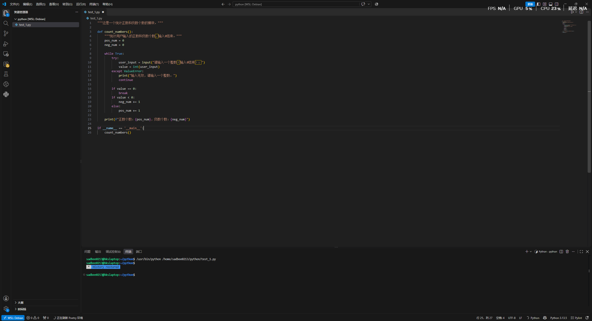

## 代码规范

实际写代码时需要方便他人以及未来的自己看懂代码，因此除了代码能跑之外，还需要遵守一些规范。

### Pylint 

Pylint是一款插件，作用是:

- 检查潜在错误
- 检查代码风格
- 给出评分和报告



示例代码
````python
"""这是一个统计正数和负数个数的模块。"""

def count_numbers():
    """统计用户输入的正数和负数个数，输入0结束。"""
    pos_num = 0
    neg_num = 0

    while True:
        try:
            user_input = input("请输入一个整数（输入0结束）：")
            value = int(user_input)
        except ValueError:
            print("输入无效，请输入一个整数。")
            continue

        if value == 0:
            break
        if value < 0:
            neg_num += 1
        else:
            pos_num += 1

    print(f"正数个数：{pos_num}，负数个数：{neg_num}")

if __name__ == '__main__':
    count_numbers()
````

- 在代码开头用三个双引号讲代码的内容;
- 注意变量命名，小写为变量，大写为常量;
- 一行不要过多字符；

右下角会有 Pylint 对于代码的评分，满分十分

### pass 占位符

如果一段代码写了一部分之后暂时不写，可以用`` pass ``，跳过这部分代码

### 类型注释

````python
def average(scores: list[float]) -> float:
    """返回平均分。"""
    return sum(scores) / len(scores)


def greet(name: str, times: int = 1) -> str:
    return f"你好，{name}！" * times
````

这段代码中的 -> 和 : int 就是类型注释，不影响代码运行，方便人看数据类型。